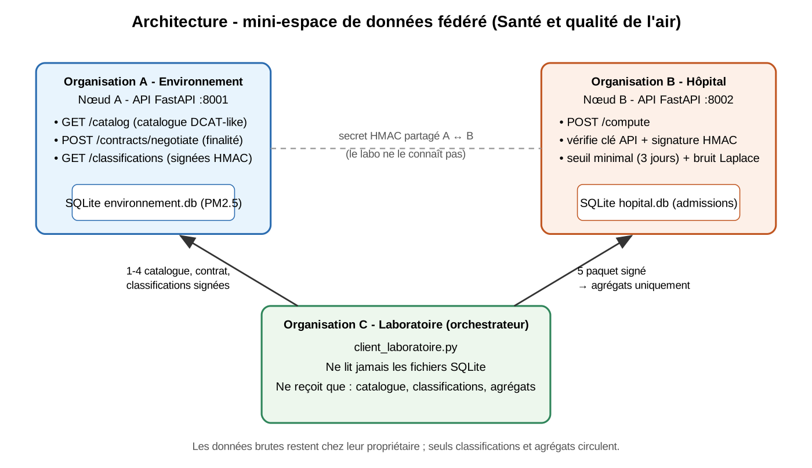
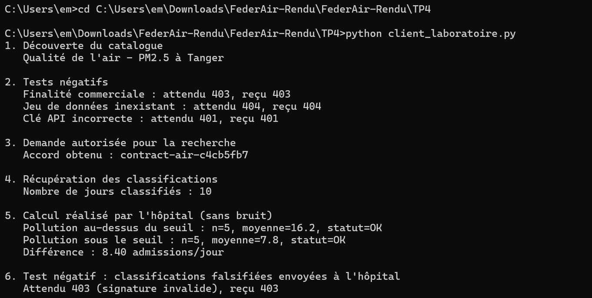
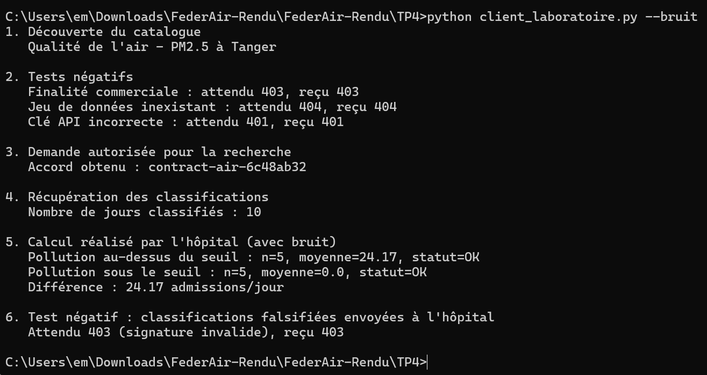

# Rapport - Mini-espace de données fédéré (Santé et qualité de l'air)

Master IASD - Data Spaces & Data Integration & Semantic Interoperability

> Captures d'écran : dossier `rapport/captures/` (liste dans `LISEZ-MOI.md`).
>
> Les sorties d'exécution citées ci-dessous sont dans `rapport/resultats/`. Le schéma d'architecture est dans `rapport/schema_architecture.png`. Les captures d'écran sont à ajouter dans `rapport/captures/` (voir `LISEZ-MOI.md`).

---

## TP 1 - Stockage fédéré

Code : `TP1/tp_federation.py`, `TP1/consulter_bases.py`.

1. **Où sont stockées les mesures de qualité de l'air ?** Dans `environnement.db` (table `qualite_air`), base SQLite locale de l'organisation A.
2. **Où sont stockées les admissions hospitalières ?** Dans `hopital.db` (table `admissions`), base SQLite locale de l'organisation B.
3. **Les deux jeux de données sont-ils dans une même base ?** Non : deux fichiers, deux schémas, deux propriétaires. Aucune base centrale n'existe.
4. **Comment le laboratoire peut-il découvrir les données sans centraliser les fichiers ?** Grâce à un catalogue de métadonnées (titre, description, éditeur, couverture temporelle, unité, finalité autorisée) publié par chaque organisation. Le laboratoire lit la description du jeu de données, pas les données. C'est ce que fait `GET /catalog` au TP 4.

## TP 2 - Communication par API REST

Code : `TP2/api_air.py`, `TP2/api_hopital.py`, `TP2/client_analyse.py`.

1. **Rôle de FastAPI ?** C'est le framework Python qui définit les routes (`/mesures`, `/admissions`...), valide les données et génère la documentation Swagger (`/docs`).
2. **Rôle de Uvicorn ?** C'est le serveur ASGI qui exécute l'application FastAPI et écoute les requêtes HTTP sur un port.
3. **Pourquoi deux ports ?** Chaque organisation est un service indépendant ; deux processus ne peuvent pas écouter le même port. 8001 = environnement, 8002 = hôpital.
4. **Le laboratoire reçoit-il les données brutes ?** Oui : il reçoit toutes les valeurs de PM2.5 et toutes les admissions journalières. C'est la limite de cette version.
5. **Une API REST garantit-elle la confidentialité ?** Non. REST n'est qu'un style de communication ; sans authentification, autorisation, chiffrement (HTTPS) et limitation de ce qui est exposé, tout est lisible.

Résultat obtenu : 16,0 admissions en moyenne les 3 jours où PM2.5 > 30, contre 8,5 les 2 autres jours (`rapport/resultats/TP2_client_analyse.txt`).

## TP 3 - Calculs locaux, contrôle d'accès et attaque par différence

Code : `TP3/api_air_v3.py`, `TP3/api_hopital_v3.py`, `TP3/laboratoire_v3.py`, `TP3/attaque_difference.py`, `TP3/tests_acces.py`.

1. **Données reçues par le laboratoire ?** TP 2 : les valeurs brutes (PM2.5 et admissions). TP 3 : uniquement les dates avec leur catégorie (`elevee` / `non_elevee`) de la part de A, puis des moyennes et effectifs de la part de B.
2. **Pourquoi l'hôpital calcule-t-il chez lui ?** Pour que les admissions ne quittent jamais sa base : on déplace le calcul vers la donnée, pas la donnée vers le calcul. Cela préserve la souveraineté et réduit la surface d'exposition.
3. **Informations encore transmises à l'hôpital ?** Les classifications journalières (date + catégorie) : l'hôpital apprend quels jours étaient pollués. Ce sont des informations échangées.
4. **Une statistique agrégée garantit-elle la confidentialité ?** Non. L'attaque par différence (`attaque_difference.py`) demande une « moyenne » sur un seul jour et obtient `{'non_elevee': {'nombre_jours': 1, 'moyenne_admissions': 8.0}}` : la valeur individuelle du 1er octobre est révélée. Un agrégat sur un groupe choisi librement peut isoler un individu ou un jour.
5. **Une clé API suffit-elle pour la souveraineté ?** Non. Elle authentifie l'appelant mais ne dit rien de la finalité, de la forme des requêtes, des quantités révélées ni de la durée d'usage. Quiconque possède la clé peut poser n'importe quelle question autorisée par l'API.
6. **Comment limiter les demandes aux opérations autorisées ?** Contrat lié à une finalité, signature des classifications par A (le laboratoire ne peut plus choisir ses groupes), seuil minimal de taille de groupe, bruit calibré, budget de confidentialité, journaux d'accès : c'est le TP 4.
7. **Composants supplémentaires pour un vrai espace de données ?** Identités organisationnelles (certificats, vérification d'identité), catalogue et protocole de négociation de contrats standardisés (DCAT, ODRL, connecteurs type Eclipse Dataspace Connector / IDS / Gaia-X), HTTPS, gestion sécurisée des secrets, autorisations fines, traçabilité et journaux d'audit, analyse des risques de divulgation, gouvernance.

Tests du contrôle d'accès (5/5 réussis) : `rapport/resultats/TP3_tests_acces.txt`.

## TP 4 - Gouvernance et confidentialité

Code : `TP4/setup_data.py`, `TP4/api_air.py`, `TP4/api_hopital.py`, `TP4/client_laboratoire.py` (conformes à l'énoncé). Version étendue : `extension_FederAir/`.

### Calculs manuels

| Date | PM2.5 | Admissions | Catégorie |
|---|---|---|---|
| 01/10 | 12,0 | 8 | sous_seuil |
| 02/10 | 35,5 | 14 | au_dessus_seuil |
| 03/10 | 42,1 | 18 | au_dessus_seuil |
| 04/10 | 15,2 | 9 | sous_seuil |
| 05/10 | 38,0 | 16 | au_dessus_seuil |
| 06/10 | 45,0 | 20 | au_dessus_seuil |
| 07/10 | 22,1 | 10 | sous_seuil |
| 08/10 | 18,0 | 7 | sous_seuil |
| 09/10 | 31,0 | 13 | au_dessus_seuil |
| 10/10 | 11,5 | 5 | sous_seuil |

- Au-dessus du seuil : (14 + 18 + 16 + 20 + 13) / 5 = 81 / 5 = **16,2**
- Sous le seuil : (8 + 9 + 10 + 7 + 5) / 5 = 39 / 5 = **7,8**
- Différence : 16,2 - 7,8 = **8,4 admissions par jour**

Le programme sans bruit donne exactement ces valeurs (`rapport/resultats/TP4_client_laboratoire.txt`).

**Capture - exécution sans bruit** (`python client_laboratoire.py`) : moyennes 16,2 et 7,8, différence 8,40, trois tests négatifs (403, 404, 401) et signature falsifiée refusée (403).

**Capture - exécution avec bruit** (`python client_laboratoire.py --bruit`) : les moyennes changent (ici 24,17 et 0,0 au lieu de 16,2 et 7,8) ; les effectifs restent à 5.

### Réponses aux questions

1. **Informations pour découvrir et comprendre le jeu de données ?** Le catalogue : identifiant, titre, description, éditeur, couverture temporelle (2026-10-01/2026-10-10), unité (µg/m³), point d'accès et finalité autorisée.
2. **Qu'est-ce que DCAT et pourquoi une simplification ?** DCAT (Data Catalog Vocabulary) est un vocabulaire du W3C, en RDF, pour décrire des catalogues, jeux de données et distributions de façon interopérable. Notre catalogue est un simple JSON avec quelques champs inspirés de DCAT : pas de RDF, pas d'URI de vocabulaires, pas de distributions ni de licences, donc non conforme au standard.
3. **Pourquoi contrôler la finalité avant l'accès ?** Parce qu'une donnée légitime pour la recherche peut être illégitime pour un usage commercial : l'accès doit dépendre de l'usage prévu. *Catalogue* : décrit ce qui existe (découverte). *Politique d'usage* (inspirée d'ODRL) : dit ce qui est permis, pour quelle finalité. *Contrôle d'accès* : applique techniquement la règle (clé API, vérification de la finalité, du consommateur, du contrat).
4. **Informations qui circulent ? Que reste-t-il dans la base hospitalière ? Pourquoi la conservation locale ne suffit-elle pas ?** Circulent : le catalogue, le contrat, les classifications signées (date + catégorie) de A vers C puis B, et des agrégats (effectifs et moyennes) de B vers C. Restent dans `hopital.db` : toutes les admissions journalières individuelles. La conservation locale ne suffit pas, car les agrégats et les classifications sont eux-mêmes des informations qui peuvent révéler des valeurs individuelles (cf. attaque par différence) ; il faut aussi limiter ce que l'on calcule et ce que l'on publie.
5. **Pourquoi ne pas publier une statistique sur un groupe trop petit ? Pourquoi le seuil de 3 jours n'est-il pas du k-anonymat ? Comment la signature limite-t-elle l'attaque du TP 3 ?** Une moyenne sur 1 ou 2 jours révèle presque directement les valeurs individuelles. Le seuil de 3 est une règle simple de non-publication : le k-anonymat est une propriété formelle d'un jeu de données (chaque individu indistinguable d'au moins k-1 autres sur les quasi-identifiants), que ce seuil ne démontre pas ; par ailleurs plusieurs requêtes peuvent se recouper. La signature HMAC prouve que la liste de classifications a été émise par A pour ce contrat : le laboratoire ne peut plus choisir lui-même un groupe d'un seul jour, toute modification donne 403 (testé).
6. **Résultats avec et sans bruit ; compromis ; pourquoi pas une DP complète ?** Sans bruit : 16,2 et 7,8 (exacts). Avec bruit (ε = 1) les moyennes changent à chaque exécution et peuvent être très éloignées (par ex. 24,17 et 0,0 dans la capture 14, la valeur négative étant ramenée à 0 par le post-traitement), car l'écart-type est d'environ 8,5 pour n = 5, comparable à la différence observée. Plus ε est petit, plus la protection est forte et plus le résultat est imprécis : compromis précision/protection. Ce n'est pas une confidentialité différentielle complète : sensibilité simplifiée (borne pédagogique de 30 admissions/jour, groupes de taille fixée), effectifs `n` publiés sans bruit, budget suivi par simple somme, partition des jours dépendant des données A, aléa non audité, pas d'analyse formelle de la composition des requêtes.
7. **La différence permet-elle de conclure que la pollution provoque les admissions ?** Non : c'est une association sur 10 jours fictifs, pas une causalité. Il faudrait considérer : météo (température, humidité, vent), saison, épidémies virales et grippe, jours de la semaine et jours fériés, population exposée, autres polluants (NO2, O3, PM10), délai entre exposition et admission, tendance, capacité de l'hôpital, et utiliser un modèle statistique adapté (séries temporelles, régression de Poisson avec décalages) sur une longue période.

### Tests négatifs réalisés (au moins trois demandés)

| Test | Résultat attendu | Résultat obtenu |
|---|---|---|
| Finalité `commercial` | 403 | 403 |
| Jeu de données inexistant | 404 | 404 |
| Clé API incorrecte | 401 | 401 |
| Signature falsifiée (sous-ensemble de dates) | 403 | 403 |
| Rejeu du même paquet (extension FederAir) | 409 | 409 |
| 4ᵉ appel avec bruit et ε = 1 (extension FederAir) | 429 | 429 |

---

## Conclusion

- **Stockage fédéré (TP 1)** : les données restent chez leurs propriétaires, dans deux bases indépendantes. Rien n'est centralisé, mais rien ne permet encore de communiquer.
- **Traitement fédéré (TP 3)** : le calcul est effectué là où se trouve la donnée (chez l'hôpital) et seules des statistiques sont renvoyées. Mais le laboratoire choisit librement ses groupes, et l'attaque par différence révèle une valeur individuelle (8,0).
- **Analyse fédérée (TP 4)** : plusieurs organisations contribuent à une même analyse sous gouvernance : catalogue pour la découverte, contrat et vérification de la finalité, classifications signées, calcul local, seuil minimal, bruit et budget de confidentialité.

**Ce que le TP 4 corrige par rapport au TP 3** :
1. L'attaque par différence est bloquée par la signature HMAC : le laboratoire ne peut plus choisir ses groupes (403) ; les groupes de moins de 3 jours ne sont pas publiés ; le bruit limite l'exactitude des valeurs publiées.
2. L'hôpital ne se contente plus d'une clé API : l'accès repose sur un contrat lié à une finalité (`research`) et à un consommateur identifié.
3. Le laboratoire dispose d'un catalogue pour découvrir les jeux de données.

**Limites restantes** : les classifications et les agrégats circulent toujours ; le bruit n'est pas une garantie formelle de confidentialité différentielle ; les clés et secrets sont des valeurs de démonstration ; il n'y a ni HTTPS, ni identités organisationnelles, ni journaux d'audit. Le prototype ne doit pas être exposé sur Internet ni utilisé avec des données réelles.

*Extension (au-delà de l'énoncé) :* `extension_FederAir/` ajoute contrats persistants et révocables en SQLite, anti-rejeu (nonce + horodatage), budget epsilon persistant, interface web et modèles ML locaux. Il n'implémente pas d'apprentissage fédéré (pas d'agrégation de poids).
